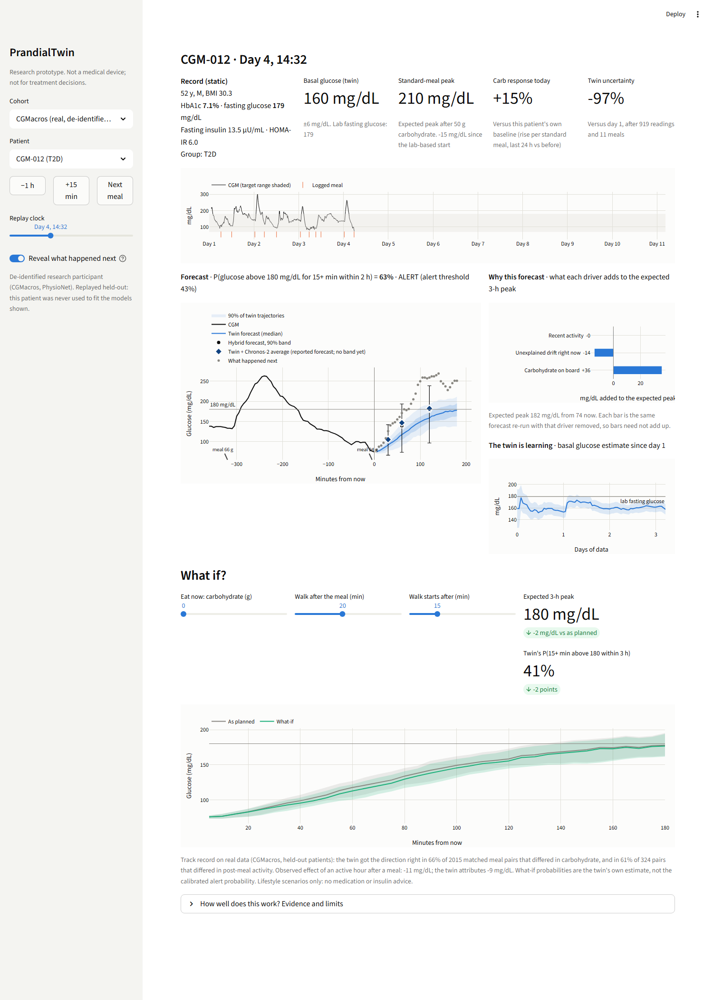
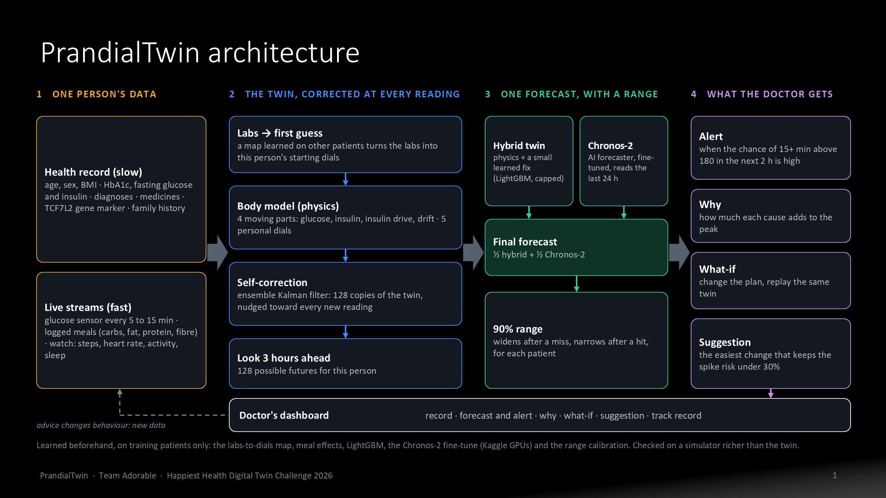
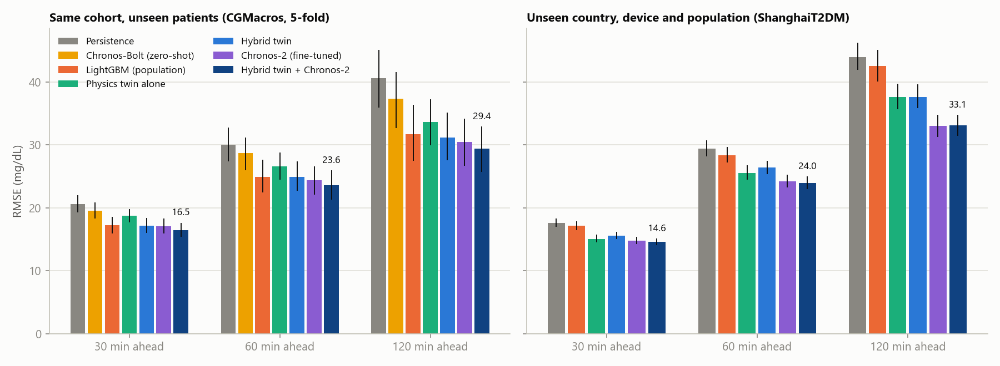
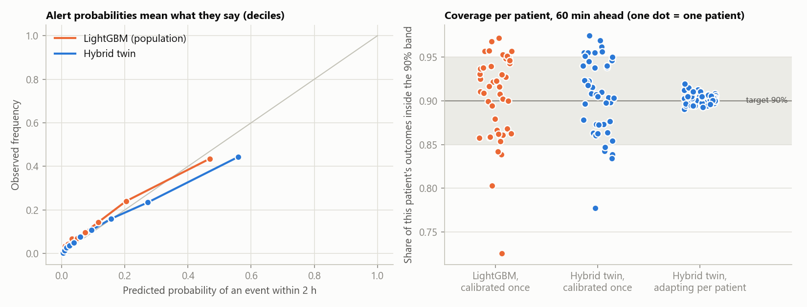

# PrandialTwin

**A physiological digital twin for type 2 diabetes and prediabetes that starts from a patient's lab record,
updates itself at every glucose reading, warns of post-meal hyperglycaemia before it happens, and answers
"what if they eat less or walk after lunch" from the patient's own current state.**

Submission for the Happiest Health Digital Twin Challenge 2026 (Reimagining and Reforming Healthcare in India Summit, Bengaluru).

> Research prototype. Not a medical device, not validated on Indian patients, not for treatment decisions.



## 1. Team

| | |
|---|---|
| Team name | Adorable |
| College / incubator | Vellore Institute of Technology, Vellore (Tharun J, team leader); ABES Institute of Technology, Ghaziabad (Gargi Sharma). Inter-college team; no incubator |
| Team leader | Tharun J (Vellore Institute of Technology, Vellore) |
| Members | Tharun J, Gargi Sharma |

## 2. Project title

PrandialTwin: a self-updating, self-auditing digital twin for post-meal hyperglycaemia.

## 3. Problem statement and healthcare use case

India has 11.4% diabetes and 15.3% prediabetes prevalence (ICMR-INDIAB-17) on a diet that averages 61.6% of
energy from carbohydrate. In 649 Indian patients on a first glucose sensor, 53.5% of the time was spent above
range. HbA1c every three months hides this; a 14-day CGM report shows it, but only afterwards.

**Use case.** A physician places a 10 to 14 day CGM on a patient with type 2 diabetes or prediabetes. The twin
turns that stream, the patient's labs and their meal log into a forward view:

| Question the doctor asks | What the twin gives |
|---|---|
| Will this meal push them above 180 mg/dL? | Probability of glucose above 180 mg/dL for 15+ minutes in the next 2 to 3 hours, with a calibrated band |
| Why? | The contribution of carbohydrate on board, current drift and recent activity to the expected peak |
| What would help? | The same forecast re-run with a smaller portion, a different meal or a walk |
| Can I trust that? | The track record of such what-ifs on real matched meals, shown next to the answer |
| Is today unusual for this patient? | Today's carbohydrate response against their own baseline |

**The two data streams the brief requires, fused for the same person:**

- Static record: age, sex, weight, BMI, HbA1c, fasting glucose, fasting insulin. These never enter as feature columns. They set the prior on the twin's physiological parameters.
- Dynamic streams: CGM every 5 or 15 minutes, logged meals with macronutrients, smartwatch activity. Each reading updates the twin.

**Adverse event predicted:** CGM above 180 mg/dL for at least 15 consecutive minutes, forecast only while
glucose is still at or below 180 (a new excursion, not one already under way).

## 4. What is new, and what is not

Rival entries in this challenge already predict glucose above 180 with boosted trees and a what-if slider, mostly
on data they generated themselves; one adds a physiology model and conformal bands. The methods we use are
established (minimal-model physiology, ensemble Kalman filter, LightGBM, conformal prediction). What this
project adds is evidence:

1. **Real linked data as the primary evidence.** 45 real people (CGMacros), patient-level cross-validation. Synthetic data is used only to verify the method.
2. **A twin that is never fitted to its patient.** A new patient gets a prior from their labs and online updates. Nothing else.
3. **An unseen cohort.** Trained in the USA, run unchanged on 109 Chinese recordings (other device, treated T2D, no wearable).
4. **Uncertainty reported per patient**, not pooled.
5. **What-ifs tested against real behaviour** (matched meals within the same person) and against true counterfactuals in a simulator richer than the twin.
6. **The strongest rivals tested, not assumed away.** GRU, LSTM, a patch transformer and the Chronos-2 foundation model (zero-shot and fine-tuned) on the same folds and the same external cohort, including the one model that beat the twin abroad. The reported forecast now averages the twin with fine-tuned Chronos-2.
7. **Advice that is tested.** At each meal the twin suggests the least-effort change (smaller portion, a walk) that brings its spike risk under 30%. On synthetic patients, where every action's true outcome is known, this cut meals with a spike from 35% to 18% (an oracle reached 11%).

Detail and literature comparison: [research/DECISION_REPORT.md](research/DECISION_REPORT.md), [research/METHODS_COMPARISON.md](research/METHODS_COMPARISON.md).

## 5. Architecture



PDF: [docs/architecture.pdf](docs/architecture.pdf) (the same diagram is slide 9 of the presentation).

| Layer | What it does | File |
|---|---|---|
| Physiology | 4 states (glucose, insulin action, insulin drive, unexplained drift), 5 patient parameters (basal glucose, insulin-mediated disposal, absorption rate, carbohydrate sensitivity, activity uptake). Closed-form gut absorption; exponential integrator stable at 5 and 15 minutes | `twin/core.py` |
| Labs to prior | Ridge map from HbA1c, fasting glucose, fasting insulin and BMI to each parameter, learned on training patients | `twin/core.py` |
| Assimilation | Ensemble Kalman filter, 128 members; states and parameters corrected at every reading; coasts through sensor gaps | `twin/core.py` |
| Hybrid forecast | 3-hour ensemble rollout plus a LightGBM correction capped at 20 / 30 / 40 mg/dL; the reported forecast averages it with fine-tuned Chronos-2 | `twin/hybrid.py`, `twin/evaluate.py` |
| Uncertainty | Conformalized quantile regression, then adaptive conformal inference per patient | `twin/hybrid.py` |
| What-if and advice | Edit the future of the record (portion, extra meal, walk) and re-run from the same filtered state; try 8 actions and suggest the least-effort one under 30% risk (`core.recommend`) | `twin/core.py` |
| Baselines | Persistence; population LightGBM on window + meal + lab features; GRU, LSTM, patch transformer; Chronos-Bolt and Chronos-2 zero-shot; Chronos-2 fine-tuned in each fold | `twin/hybrid.py`, `twin/neural_baselines.py`, `twin/chronos_baseline.py` |
| Synthetic generator | Linked EHR + wearable streams from a reference simulator richer than the twin; Synthea-style export | `twin/synth.py` |
| Evaluation | Cross-validation, ablations, robustness, external cohort, verification, report | `twin/evaluate.py`, `twin/report.py` |
| Dashboard | Streamlit + Plotly | `app.py` |

**Technical stack:** Python 3.11, NumPy, SciPy, pandas, scikit-learn, LightGBM, Matplotlib, Plotly, Streamlit, pytest.
Optional: PyTorch + chronos-forecasting for the neural and foundation-model baselines and the Chronos-2 forecast partner (a GPU makes them minutes). No LLM is used.
The twin itself runs on a laptop CPU: about 1 second to assimilate 10 days of data.

## 6. Results

Full tables with intervals: [results/RESULTS.md](results/RESULTS.md). Every number comes from `python -m twin.evaluate`.
Brackets are 95% intervals from resampling patients.



### What held up

| Claim | Evidence |
|---|---|
| The twin transfers better than LightGBM and small neural networks | ShanghaiT2DM, 60-min RMSE: physics twin **25.5**, hybrid **26.4**, LightGBM 28.4, patch transformer 34.1, LSTM 40.0, GRU 43.2, persistence 29.4 mg/dL. Hybrid minus LightGBM **-2.0 (-2.6 to -1.4)**. Baselines were trained at the target site's modality |
| Paired with a foundation model, it is the most accurate forecast tested | Hybrid twin averaged with fine-tuned Chronos-2, 60-min RMSE: **23.6** at home (LightGBM 25.0; minus LightGBM -1.3 (-2.2 to -0.7)), **24.0** abroad (minus hybrid -2.4 (-2.7 to -2.1)) |
| Its alerts transfer too | ShanghaiT2DM, 2-hour alert AUPRC: hybrid **0.450** vs LightGBM 0.356; difference 0.094 (0.056 to 0.136) |
| More events caught at the same alert burden | CGMacros, about one false alert per patient-day: hybrid warns of **61%** of 693 events, LightGBM 52%; median lead 30 minutes |
| Uncertainty holds for every patient | 90% bands adapted online: all 45 patients within 5 points of 90%, worst **89%**. Calibrated once: worst 78%. On ShanghaiT2DM: worst **88%** vs 64% |
| Personalisation matters | Personalised twin vs generic physiology from day 4: **-5.6 (-9.4 to -2.1)** mg/dL |
| Learned physiology agrees with labs it never saw | Twin basal glucose vs lab fasting glucose: rho = 0.62. Twin standard-meal peak vs HbA1c: rho = 0.60 |
| What-ifs point the right way | Matched real meal pairs: direction right in 66% (carbohydrate) and 61% (activity). Observed effect of an active hour after a meal -10.7 mg/dL; the twin attributes -9.1 |
| The method recovers known truth | Synthetic patients: basal glucose rho = 0.96; "40% less carbohydrate" what-if vs true counterfactual r = 0.88, direction right in 100% |
| Its advice works where the truth is known | Synthetic patients, 773 meals: true spikes 35% with no action, 28% with a carbohydrate rule, **18%** when the twin chooses, 11% for an oracle. Twin minus nothing: -16.6 (-23.0 to -10.0) points |
| It degrades gracefully | No wearable: 60-min RMSE 25.3 vs 24.9. Carbohydrate logged with 30% error: 25.2. No meal log at all: 26.9 |
| Nothing newer beats it (19 Oct, round 2) | MOMENT, TS2Vec and a twin-informed Chronos-2, on all three datasets: none beats hybrid twin + Chronos-2 on either real cohort; re-training Chronos-2 reproduces it to within 0.05 mg/dL. On six simulated Indian regions the hybrid twin alone is best (15.3 vs Chronos-2 17.6). [results/ROUND2.md](results/ROUND2.md) |

### What did not hold up

| Hoped for | Found |
|---|---|
| Better accuracy than LightGBM on the home cohort | **A tie.** CGMacros 60-min RMSE: hybrid 24.9, LightGBM 25.0; difference -0.02 (-0.71 to 0.57). Meal-time event AUPRC 0.695 vs 0.700 |
| Labs give a clear head start | First 24 hours: -0.46 mg/dL (-1.01 to 0.10). **Not significant.** On ShanghaiT2DM the lab-based prior was slightly worse than the population prior (25.5 vs 25.2 mg/dL): the map does not transfer to a treated population |
| The twin keeps getting better with data | Updating vs frozen twin from day 4: -0.87 (-2.14 to 0.26). **Not significant**, and updating costs accuracy in the first three days |
| Twin what-ifs beat an associative model | **No.** On carbohydrate pairs LightGBM got the direction right slightly more often (68% vs 66%) |
| The twin transfers better than any model | **No.** Fine-tuned Chronos-2 alone beats the hybrid abroad: 24.2 vs 26.4 mg/dL (minus hybrid -2.2 (-2.6 to -1.8)). We had written that fine-tuning needs more than 45 people; it does not. Chronos-2 is now averaged into the forecast |
| Small neural networks add accuracy | **No.** At home GRU 25.1, LSTM 25.3, patch transformer 24.7 vs LightGBM 25.0: ties. Abroad they over-predict at every hour (mean error +13 to +19 mg/dL) |
| A clean "rise above basal" tolerance index | Unrelated to HbA1c (basal glucose and carbohydrate sensitivity trade off). We report the absolute standard-meal peak instead |

The honest summary: on its home cohort the twin matches a well-built standard model while also giving a state,
an explanation, a what-if and a tested suggestion. Away from home it is clearly better than LightGBM and small networks,
a fine-tuned foundation model is better still, and the two averaged are the best forecast we tested. Its uncertainty
stays honest for each patient.



### Validated, or only simulated?

| Capability | Status |
|---|---|
| Glucose and event forecasts, alert policy, uncertainty bands | Validated retrospectively on real held-out patients and on an unseen real cohort |
| What-if for portion and post-meal activity | Checked for consistency on real matched meals (not randomised); verified against true counterfactuals on synthetic patients |
| What-if for an added meal or a walk of a chosen length | Simulated from the twin's physiology only |
| Suggested change at a meal | Verified against true counterfactuals on synthetic patients only; no real-world test |
| Twin + Chronos-2 forecast | Validated retrospectively at home and abroad; the dashboard draws it for real patients from the cached held-out Chronos-2 forecasts (every 15 min; no band yet) |
| Live updating | Real recordings replayed in time order; no prospective use |
| Indian patients | No real data; simulated only, in six regional cohorts built from ICMR-INDIAB-21 and Indian food tables (`results/INDIA.md`) |
| Drug and insulin effects, clinical outcomes | Not covered |

## 7. Run it

```bash
python -m venv .venv
.venv/Scripts/python -m pip install -e ".[dev]"     # Linux/macOS: .venv/bin/python

streamlit run app.py                                 # dashboard, works immediately on synthetic patients

python -I -m twin.data                               # download CGMacros + ShanghaiT2DM (about 2 minutes, 10 MB)
python -I -m twin.synth                              # write the synthetic cohort as CSV to data/synthetic/
python -I -m twin.india                              # six regional Indian synthetic cohorts + the twin tested in each (results/INDIA.md)
pip install -e ".[chronos]"                          # optional: PyTorch + Chronos for the baselines below
python -I -m twin.neural_baselines                   # GRU, LSTM, patch transformer (about 15 minutes on a laptop GPU)
python -I -m twin.chronos_baseline                   # Chronos-Bolt and Chronos-2, zero-shot and fine-tuned (about 1.5 h on a laptop GPU)
python -I -m twin.evaluate                           # all experiments, figures, RESULTS.md (about 35 minutes, 8 cores)
python -I -m pytest -q                               # 15 verification tests, no dataset needed
```

GPU runs on Kaggle (optional): `python -I -m twin.tsfm export` builds `kaggle/prandialtwin_kit.zip` (upload it as a
private dataset), then `kaggle/run_chronos.ipynb` and `kaggle/run_tsfm.ipynb`; merge the outputs with
`python -I -m twin.chronos_baseline merge` and `python -I -m twin.tsfm merge`.

`python -I` keeps the interpreter from importing anything that sits next to downloaded files.
Exact package versions used for the reported numbers: `requirements-lock.txt`.

The dashboard opens a specific moment from its URL, for example
`?cohort=cgmacros&patient=CGM-012&i=932&reveal=1&portion=70&walk=20`. Real patients are replayed held-out once
`twin.evaluate` has produced the per-fold models; before that they use the shipped model and say so.

## 8. Data

| Dataset | Role | Licence | Notes |
|---|---|---|---|
| CGMacros v1.0.0 (PhysioNet) | Development, cross-validation | CC BY-NC-SA 4.0 | 45 adults: labs, Dexcom CGM, Fitbit, meals with macros |
| ShanghaiT2DM (figshare) | External validation only | CC BY 4.0 | 109 recordings, 15-minute CGM, meals as free text, half on insulin |
| Synthetic cohort (`twin.synth`) | Verification and demo | MIT | 60 virtual patients, Indian meals, Synthea-style EHR tables |
| Regional Indian cohorts (`twin.india`) | Verification and demo on Indian diets | MIT | 6 x 60 simulated adults (North, South, East, West, Central, Northeast): ICMR-INDIAB-21 populations, Indian Nutrient Databank plates, measured Indian GIs |

No raw data is stored in this repository. Catalogue with schema, provenance, handling decisions and the datasets we
rejected: [research/DATASETS.md](research/DATASETS.md).

## 9. Limitations

- **Small and not Indian.** 45 people from the USA and 100 from China. No open Indian CGM dataset with linked labs was found. The India case rests on problem fit, not on measured accuracy in Indians. Six simulated regional Indian cohorts (`results/INDIA.md`) test the method on Indian plates and lifestyles where the truth is known; they are not evidence about real Indians.
- **Retrospective.** Replayed recordings, no prospective or clinical-outcome evaluation.
- **No drug or insulin model.** Their effects land in the twin's drift term. Half of the external cohort is on insulin.
- **Meals must be logged.** Without any meal log the 60-minute error rises by 8%. External-cohort meals come from a 12-row keyword table.
- **Natural experiments are not trials.** Matched pairs can still differ in ways we did not match.
- **Parameters are not all separately identifiable.** Basal glucose is well determined; carbohydrate sensitivity and insulin-mediated disposal trade off. The dashboard shows combined, identifiable summaries.
- **Advice is tested on simulated patients only.** The simulator is richer than the twin but from the same family of model, so the measured benefit is an upper bound. Lifestyle actions only.
- **Chronos-2 caveats.** One fine-tuning run per fold; its pretraining data might include public CGM sets; the averaged forecast has no conformal bands yet.
- **Development choices.** Filter noise levels were set on nine patients, and the model structure was revised twice using cross-validated results. Results are also reported without those nine. The external cohort was never used to choose anything.

## 10. Repository map

```
app.py                  clinician dashboard
twin/                   data, synth, india (regional cohorts), core (the twin), hybrid, evaluate, report, neural_baselines, chronos_baseline, tsfm
kaggle/                 GPU notebooks (Chronos-2; Moirai, MOMENT, TS2Vec) and their standalone runner
tests/test_twin.py      mass balance, steady state, leakage guard, filter learning, conformal coverage, ...
results/                RESULTS.md, ROUND2.md, INDIA.md, metrics.json, india.json, figures/, models.pkl.gz
research/               DECISION_REPORT, LITERATURE_REVIEW, METHODS_COMPARISON, DATASETS, BIBLIOGRAPHY, fetch_papers.py
docs/                   final presentation, earlier technical deck, architecture.pdf and .png, demo clips, image credits, dashboard screenshot
context/scripts/        scoring scripts behind results/ROUND2.md and the India re-score
PROGRESS.md             build log
```

## 11. Submission items

| Item | Where |
|---|---|
| Repository / folder name | `Adorable_Vellore_Institute_of_Technology` ([github.com/iamtharunj/Adorable_Vellore_Institute_of_Technology](https://github.com/iamtharunj/Adorable_Vellore_Institute_of_Technology)); the brief's format is Team Name_College Name |
| Demo video (unlisted YouTube) | [https://youtu.be/0C00zOSXh2Q](https://youtu.be/0C00zOSXh2Q) |
| Dashboard | Run locally with `streamlit run app.py`. It opens on the simulated and Indian cohorts with no download; the real cohorts need `python -m twin.data` first |
| Architecture diagram | [docs/architecture.pdf](docs/architecture.pdf) |
| Presentation | [docs/PrandialTwin_Final.pptx](docs/PrandialTwin_Final.pptx), [docs/PrandialTwin_Final.pdf](docs/PrandialTwin_Final.pdf) (24 slides: problem, how the data are made and why they can be trusted, the architecture step by step, each formula with a plain-words explanation, why the best models won and the others lost, four live demos, India, references for every number on slide 24; speaker notes carry the two-person narration; [image credits](docs/IMAGE_CREDITS.md)). Earlier technical deck: [docs/PrandialTwin.pdf](docs/PrandialTwin.pdf) |
| Licence | Code: MIT ([LICENSE](LICENSE)). Fitted models and result files derived from CGMacros: CC BY-NC-SA 4.0. Datasets keep their own licences and are not redistributed |
| Public access | This repository is public. All files and links listed in this README are publicly accessible without additional permissions; the demo video is an unlisted YouTube link that anyone with the link can watch |

## 12. References

Key sources; the full list is in [research/BIBLIOGRAPHY.md](research/BIBLIOGRAPHY.md).

- National Academies (2023). Foundational Research Gaps and Future Directions for Digital Twins.
- Tudor BH, et al. (2025). A scoping review of human digital twins in healthcare. npj Digital Medicine.
- Das A, et al. (2025). CGMacros. Scientific Data 12:1557. PhysioNet doi:10.13026/3z8q-x658.
- Zhao Q, et al. (2023). Chinese diabetes datasets for data-driven machine learning. Scientific Data 10:35.
- Bergman RN, et al. (1979). Quantitative estimation of insulin sensitivity. Am J Physiol.
- Romano Y, et al. (2019). Conformalized quantile regression. Gibbs I, Candès E (2021). Adaptive conformal inference.
- Ansari AF, et al. (2025). Chronos-2: from univariate to universal forecasting. arXiv:2510.15821.
- Grinsztajn L, et al. (2022). Why do tree-based models still outperform deep learning on tabular data? NeurIPS.
- Watkins CJCH, Dayan P (1992). Q-learning. Machine Learning 8:279-292.
- Anjana RM, et al. (2023). ICMR-INDIAB-17. Lancet Diabetes Endocrinol.
