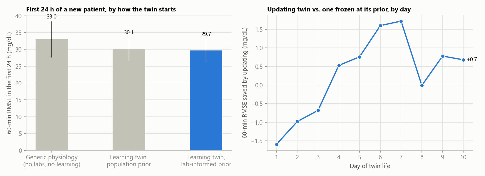
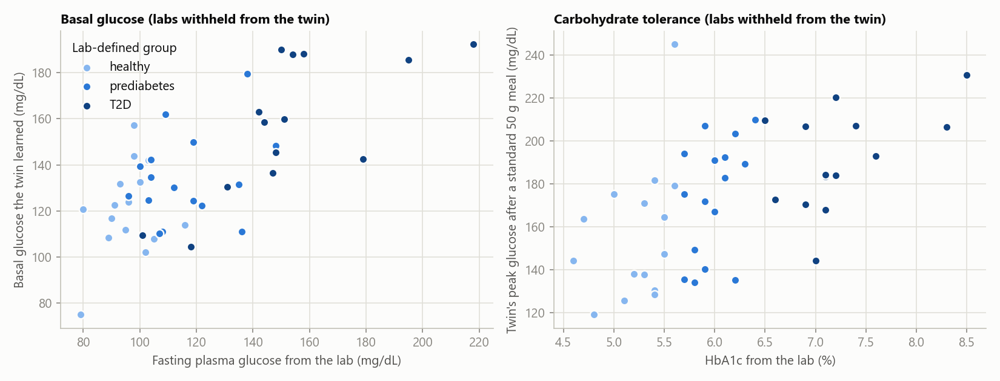
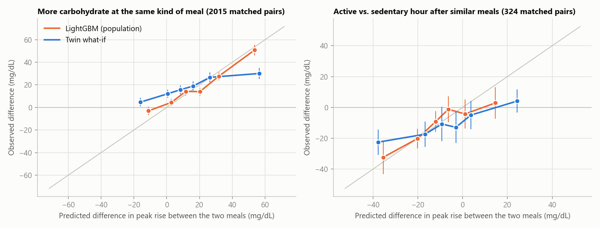
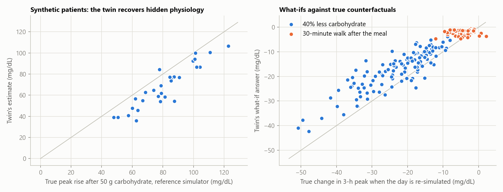
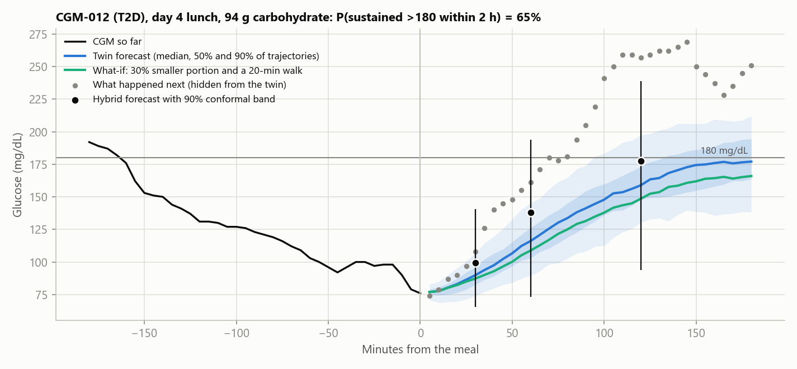
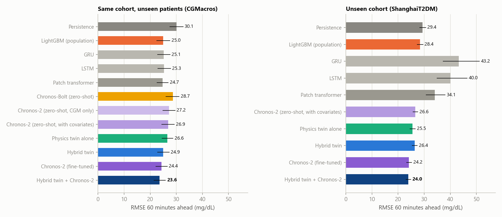
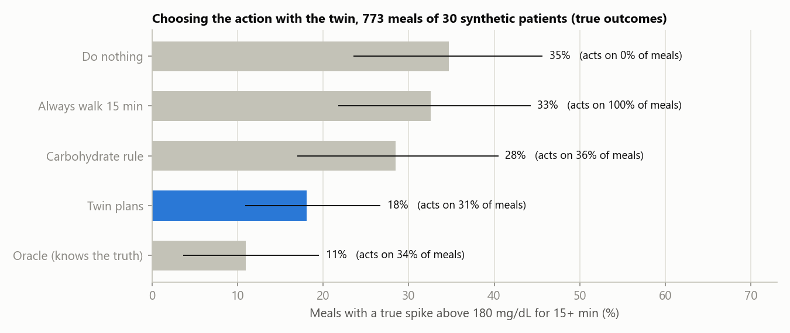

# Results

Generated by `python -m twin.evaluate`. Numbers in brackets are 95% intervals from resampling patients.
All CGMacros results are for patients the models never trained on (5-fold, patient-level, stratified
by glycaemic group); a test patient is only ever seen online, one reading at a time.

Cohort: 45 people (16 prediabetes, 15 healthy, 14 T2D), 41,950 rolling forecasts, 1,643 logged meals.

## 1. Forecast accuracy (RMSE, mg/dL)

**CGMacros, unseen patients**

| Model | 30 min | 60 min | 120 min |
|---|---|---|---|
| Persistence | 20.6 (19.3 to 22.0) | 30.1 (27.4 to 32.7) | 40.6 (35.9 to 45.1) |
| Chronos-Bolt (zero-shot) | 19.6 (18.4 to 20.9) | 28.7 (26.0 to 31.2) | 37.4 (32.7 to 41.6) |
| LightGBM (population) | 17.2 (16.0 to 18.6) | 25.0 (22.4 to 27.7) | 31.7 (27.5 to 36.3) |
| Physics twin alone | 18.7 (17.7 to 19.9) | 26.6 (24.5 to 28.8) | 33.7 (29.9 to 37.2) |
| Hybrid twin | 17.2 (16.0 to 18.4) | 24.9 (22.7 to 27.4) | 31.2 (27.5 to 35.2) |
| Chronos-2 (fine-tuned) | 17.1 (15.9 to 18.4) | 24.4 (22.1 to 26.6) | 30.5 (26.7 to 34.1) |
| Hybrid twin + Chronos-2 | 16.5 (15.4 to 17.7) | 23.6 (21.3 to 26.0) | 29.4 (25.7 to 32.9) |

| Paired difference | 30 min | 60 min | 120 min |
|---|---|---|---|
| Hybrid minus LightGBM | -0.06 (-0.36 to 0.23) | -0.02 (-0.71 to 0.57) | -0.50 (-2.22 to 0.94) |
| Physics twin minus persistence | -1.85 (-2.39 to -1.36) | -3.45 (-4.43 to -2.57) | -6.95 (-8.22 to -5.47) |
| Hybrid twin + Chronos-2 minus LightGBM | -0.73 (-1.03 to -0.43) | -1.33 (-2.19 to -0.73) | -2.33 (-4.32 to -0.83) |
| Hybrid twin + Chronos-2 minus hybrid twin | -0.67 (-0.86 to -0.50) | -1.31 (-1.71 to -0.88) | -1.82 (-2.56 to -1.05) |
| Share of the hybrid's predicted change supplied by physics | 0.65 | 0.713 | 0.75 |

Without the nine patients used to set the filter's noise levels: hybrid 17.6, 25.4, 31.6 vs LightGBM 17.7, 25.4, 32.1 mg/dL.

**By glycaemic group (60 min)**

| Group | Persistence | LightGBM (population) | Physics twin alone | Hybrid twin |
|---|---|---|---|---|
| T2D | 36.67 | 30.47 | 31.36 | 30.39 |
| healthy | 23.44 | 19.67 | 21.72 | 19.5 |
| prediabetes | 29.02 | 23.89 | 26.16 | 24.06 |

**ShanghaiT2DM, external (109 recordings, 51% on insulin), trained on CGMacros degraded to the target modality (15-min CGM, no wearable)**

| Model | 30 min | 60 min | 120 min |
|---|---|---|---|
| Persistence | 17.6 (17.0 to 18.4) | 29.4 (28.2 to 30.7) | 44.0 (41.9 to 46.2) |
| LightGBM (population) | 17.1 (16.5 to 17.8) | 28.4 (27.2 to 29.6) | 42.5 (40.1 to 45.1) |
| Physics twin alone | 15.1 (14.6 to 15.7) | 25.5 (24.5 to 26.7) | 37.6 (35.7 to 39.7) |
| Hybrid twin | 15.6 (15.0 to 16.1) | 26.4 (25.4 to 27.4) | 37.6 (35.7 to 39.5) |
| Hybrid minus LightGBM | -1.57 (-1.90 to -1.25) | -1.99 (-2.64 to -1.39) | -4.90 (-6.90 to -3.13) |
| Physics twin minus LightGBM | -2.03 (-2.38 to -1.74) | -2.83 (-3.67 to -2.10) | -4.89 (-7.26 to -2.86) |

**ShanghaiT2DM, external (109 recordings, 51% on insulin), trained on CGMacros as recorded**

| Model | 30 min | 60 min | 120 min |
|---|---|---|---|
| Persistence | 17.6 (17.0 to 18.4) | 29.4 (28.2 to 30.7) | 44.0 (41.9 to 46.2) |
| LightGBM (population) | 17.3 (16.7 to 18.0) | 28.9 (27.7 to 30.1) | 41.9 (39.6 to 44.3) |
| Physics twin alone | 15.3 (14.7 to 15.9) | 26.0 (24.9 to 27.2) | 38.5 (36.5 to 40.6) |
| Hybrid twin | 14.7 (14.2 to 15.3) | 25.9 (25.0 to 27.0) | 37.8 (35.8 to 39.8) |
| Hybrid minus LightGBM | -2.57 (-2.92 to -2.26) | -2.94 (-3.69 to -2.35) | -4.15 (-5.83 to -2.55) |
| Physics twin minus LightGBM | -2.00 (-2.40 to -1.66) | -2.85 (-3.69 to -2.12) | -3.41 (-5.62 to -1.60) |

## 2. The adverse event: glucose above 180 mg/dL for at least 15 minutes

Only forecasts made while glucose is still at or below 180 mg/dL count.

**Rolling alert, event within 2 h** (CGMacros: n = 35,493, prevalence 11.5%)

| Model | AUROC | AUPRC | Brier | ECE |
|---|---|---|---|---|
| LightGBM (population) | 0.810 | 0.419 (0.359 to 0.492) | 0.084 | 0.0247 |
| Physics twin alone | 0.762 | 0.367 (0.291 to 0.439) | 0.0874 | 0.0186 |
| Hybrid twin | 0.821 | 0.427 (0.371 to 0.483) | 0.0842 | 0.0219 |

AUPRC, hybrid minus LightGBM: 0.008 (-0.037 to 0.053).

**At meal time, event within 3 h** (n = 1,550, prevalence 31.6%)

| Model | AUROC | AUPRC | Brier | ECE |
|---|---|---|---|---|
| LightGBM (population) | 0.815 | 0.700 (0.623 to 0.781) | 0.1589 | 0.0676 |
| Physics twin alone | 0.775 | 0.596 (0.501 to 0.712) | 0.1736 | 0.0622 |
| Hybrid twin | 0.815 | 0.695 (0.608 to 0.781) | 0.1648 | 0.0892 |

AUPRC, hybrid minus LightGBM: -0.005 (-0.059 to 0.043).

**Alert policy replayed on test patients** (threshold fixed on each fold's calibration patients for at most 1 false alert per patient-day; 60-min snooze)

| Model | Events warned of before onset | Median lead (min) | False alerts per patient-day |
|---|---|---|---|
| LightGBM (population) | 52% of 693 | 35.0 | 0.93 |
| Physics twin alone | 58% of 693 | 20.0 | 0.79 |
| Hybrid twin | 61% of 693 | 30.0 | 0.94 |

**ShanghaiT2DM, external** (modality-matched training)

| Task | Model | AUROC | AUPRC | Brier | ECE |
|---|---|---|---|---|---|
| 2-h alert | LightGBM (population) | 0.775 | 0.356 (0.311 to 0.404) | 0.1092 | 0.0795 |
| 2-h alert | Physics twin alone | 0.779 | 0.379 (0.343 to 0.417) | 0.0895 | 0.0124 |
| 2-h alert | Hybrid twin | 0.831 | 0.450 (0.399 to 0.499) | 0.0971 | 0.0702 |
| Meal, 3 h | LightGBM (population) | 0.726 | 0.632 (0.563 to 0.695) | 0.2329 | 0.1593 |
| Meal, 3 h | Physics twin alone | 0.790 | 0.672 (0.605 to 0.728) | 0.1831 | 0.0609 |
| Meal, 3 h | Hybrid twin | 0.780 | 0.695 (0.634 to 0.748) | 0.2062 | 0.1368 |

AUPRC, hybrid minus LightGBM: alert 0.094 (0.056 to 0.136); meal 0.063 (0.025 to 0.104).

## 3. Uncertainty: 90% bands

**CGMacros**

| Horizon | Band | Coverage | Mean width (mg/dL) | Median patient | Worst patient | Patients within 5 points of 90% |
|---|---|---|---|---|---|---|
| 30 min | hybrid, split | 0.902 | 48.5 | 0.905 | 0.785 | 82% |
| 30 min | hybrid, aci | 0.902 | 49.5 | 0.902 | 0.892 | 100% |
| 30 min | lgbm, split | 0.899 | 48.3 | 0.91 | 0.751 | 71% |
| 60 min | hybrid, split | 0.903 | 70.5 | 0.907 | 0.777 | 69% |
| 60 min | hybrid, aci | 0.902 | 73.7 | 0.903 | 0.891 | 100% |
| 60 min | lgbm, split | 0.902 | 69.3 | 0.916 | 0.725 | 76% |
| 120 min | hybrid, split | 0.913 | 90.7 | 0.926 | 0.797 | 40% |
| 120 min | hybrid, aci | 0.904 | 100.5 | 0.904 | 0.885 | 100% |
| 120 min | lgbm, split | 0.91 | 88.8 | 0.931 | 0.733 | 49% |

Spearman correlation between the hybrid band's width and its absolute error: 0.476 (30 min), 0.453 (60 min), 0.417 (120 min).

**ShanghaiT2DM, external** (calibrated on CGMacros only)

| Horizon | Band | Coverage | Mean width (mg/dL) | Median patient | Worst patient | Patients within 5 points of 90% |
|---|---|---|---|---|---|---|
| 30 min | hybrid, split | 0.897 | 48.2 | 0.905 | 0.773 | 73% |
| 30 min | hybrid, aci | 0.901 | 49.3 | 0.901 | 0.889 | 100% |
| 30 min | lgbm, split | 0.903 | 51.5 | 0.902 | 0.782 | 66% |
| 60 min | hybrid, split | 0.846 | 73.6 | 0.849 | 0.635 | 45% |
| 60 min | hybrid, aci | 0.898 | 87.2 | 0.898 | 0.875 | 100% |
| 60 min | lgbm, split | 0.878 | 80.0 | 0.872 | 0.714 | 58% |
| 120 min | hybrid, split | 0.792 | 95.3 | 0.784 | 0.527 | 28% |
| 120 min | hybrid, aci | 0.896 | 140.1 | 0.896 | 0.873 | 100% |
| 120 min | lgbm, split | 0.863 | 110.7 | 0.868 | 0.669 | 42% |

## 4. What makes it a twin: labs as priors, and learning

Physics twin alone, 60-min RMSE (mg/dL).

| Variant | First 24 h | Day 4 onward |
|---|---|---|
| Generic physiology (no labs, no learning) | 33.0 (27.6 to 38.3) | 31.4 (26.8 to 36.2) |
| Learning twin, population prior | 30.1 (26.7 to 33.6) | 26.2 (24.2 to 28.3) |
| Lab prior, never updated | 28.1 (24.6 to 31.5) | 26.7 (24.3 to 29.3) |
| Learning twin, lab prior | 29.7 (26.4 to 33.1) | 25.8 (23.9 to 27.9) |

- Lab prior minus population prior, first 24 h: -0.46 (-1.01 to 0.10) at 60 min; -0.70 (-1.52 to -0.07) at 120 min.
- Learning minus frozen, day 4 onward: -0.87 (-2.14 to 0.26).
- Personalised minus generic, day 4 onward: -5.59 (-9.37 to -2.12).

- The lab-to-prior map did not transfer: on ShanghaiT2DM the physics twin's 60-min RMSE was 25.5 with the lab prior and 25.2 with the population prior.

By day of twin life (60-min RMSE): 

| Variant | d1 | d2 | d3 | d4 | d5 | d6 | d7 | d8 | d9 | d10 |
|---|---|---|---|---|---|---|---|---|---|---|
| Generic physiology (no labs, no learning) | 32.9 | 32.94 | 31.76 | 34.17 | 30.53 | 32.22 | 32.96 | 28.51 | 31.82 | 30.81 |
| Learning twin, population prior | 30.09 | 28.93 | 27.59 | 29.43 | 24.91 | 25.58 | 26.98 | 25.34 | 26.98 | 24.07 |
| Lab prior, never updated | 28.03 | 27.42 | 26.66 | 29.79 | 25.42 | 26.67 | 28.19 | 24.66 | 27.38 | 24.39 |
| Learning twin, lab prior | 29.62 | 28.4 | 27.34 | 29.26 | 24.66 | 25.07 | 26.47 | 24.67 | 26.6 | 23.71 |
| LightGBM (population) | 26.47 | 25.92 | 25.07 | 27.57 | 22.83 | 24.29 | 25.55 | 23.43 | 25.9 | 22.49 |

## 5. Does the learned physiology mean anything?

Twin run with labs withheld (population prior), parameters averaged from day 3; Spearman rho (p):

| Twin quantity | Lab value | rho (p) |
|---|---|---|
| Basal glucose | Fasting plasma glucose | 0.62 (0) |
| Basal glucose | HbA1c | 0.58 (0) |
| Peak after a standard 50 g meal | HbA1c | 0.60 (0) |
| Peak after a standard 50 g meal | HOMA-IR | 0.37 (0.0128) |
| Rise above basal after a standard 50 g meal | HbA1c | 0.01 (0.923) |
| Insulin-mediated disposal gain | HbA1c | -0.40 (0.0063) |
| Insulin-mediated disposal gain | HOMA-IR | -0.28 (0.0645) |

Group medians of the standard-meal peak: {'T2D': 189.0, 'healthy': 147.0, 'prediabetes': 179.0}. Days 3-5 vs days 7+ of the standard-meal rise: rho = 0.99.

Leave-one-out R2 of the lab-to-prior map, per fold: fold 0: gb 0.39, phi 0.03, k 0.35, c 0.57, bex -0.02; fold 1: gb 0.43, phi 0.05, k 0.1, c 0.4, bex -0.01; fold 2: gb 0.35, phi 0.06, k 0.16, c 0.53, bex -0.03; fold 3: gb 0.33, phi -0.01, k 0.14, c 0.54, bex 0.04; fold 4: gb 0.3, phi 0.03, k 0.23, c 0.53, bex -0.07.

## 6. Are the what-ifs right? Natural experiments in real data

Within one person, pairs of meals of the same kind that start from similar glucose and differ in
one input. The twin replays each meal from its own state at meal time with the real inputs.
These pairs are not randomised, so this is a consistency check, not causal proof; the same test
is applied to the LightGBM baseline.

**More carbohydrate** (2015 pairs, 44 people, at least 25 g apart; observed mean difference in peak rise 18.0 (14.8 to 21.8) mg/dL)

| Model | Direction correct | Correlation with observed | Mean predicted difference |
|---|---|---|---|
| Twin what-if | 65.7% (62.4% to 69.0%) | 0.18 (0.09 to 0.28) | 15.3 |
| LightGBM | 68.4% (65.2% to 71.8%) | 0.46 (0.39 to 0.54) | 18.1 |

**Active vs. sedentary after the meal** (324 pairs, 40 people; mean METs 15-75 min after: at least 2.2 vs at most 1.5; observed -10.7 (-17.6 to -4.6) mg/dL)

| Model | Direction correct | Correlation with observed | Mean predicted difference |
|---|---|---|---|
| Twin what-if | 61.4% (54.0% to 68.7%) | 0.26 (0.16 to 0.36) | -6.4 |
| LightGBM | 63.3% (58.0% to 69.5%) | 0.36 (0.26 to 0.48) | -9.7 |

Effect the twin attributes to the activity itself (same meals replayed at rest): -9.1 (-11.8 to -6.8) mg/dL.

Meal-level correlation of predicted and observed peak rise: twin (true inputs) 0.47 (0.40 to 0.54); twin (forecast) 0.45 (0.38 to 0.53); LightGBM 0.62 (0.56 to 0.68); carbohydrate grams alone 0.23 (0.18 to 0.29).

## 7. Robustness on test patients

| Input | Hybrid RMSE 60 | Hybrid RMSE 120 | LightGBM RMSE 60 | Alert AUPRC (hybrid) | 90% band coverage / width, 60 min |
|---|---|---|---|---|---|
| intact | 24.93 | 31.21 | 24.95 | 0.427 | 0.903 / 70.5 |
| no wearable | 25.28 | 31.21 | 25.18 | 0.395 | 0.899 / 69.0 |
| carb error 30pct | 25.16 | 31.29 | 25.15 | 0.396 | 0.9 / 70.4 |
| no meal log | 26.91 | 35.68 | 26.66 | 0.347 | 0.899 / 77.2 |

## 8. Verification on synthetic patients with known physiology

30 synthetic patients set the population components, 30 others are twinned. The simulator is
structurally richer than the twin, so recovery is not guaranteed by construction.

- Standard-meal rise, twin vs truth: Spearman 0.885. Basal glucose: Spearman 0.959, mean absolute error 4.7 mg/dL.
- What-if 'carbs minus 40pct' (120 meals): true mean change -22.9 mg/dL, twin -17.2 mg/dL; correlation 0.875; direction correct 100%; mean absolute error 6.0 mg/dL.
- What-if 'walk 30min' (120 meals): true mean change -3.6 mg/dL, twin -1.9 mg/dL; correlation 0.169; direction correct 98%; mean absolute error 2.0 mg/dL.

## 9. Example forecast

Patient and meal picked by a fixed rule (median-error non-healthy test patient, CGM-012; first eligible lunch from day 4), not by appearance.

## 10. Model tournament: neural networks and foundation models

Same patient-level folds and the same rolling forecasts as above (RMSE, mg/dL; mean error: + = forecasts too high).
GRU, LSTM and patch transformer: 4 h of history plus the static record, 5 seeds averaged, settings fixed once before
any test result (`twin/neural_baselines.py`). Chronos: one day of history; Chronos-2 fine-tuned inside each fold
(`twin/chronos_baseline.py`). Hybrid twin + Chronos-2 = the two forecasts averaged with equal weight, fixed in advance;
LightGBM + Chronos-2 is the same blend without the twin, as a control.

**CGMacros, unseen patients**

| Model | 30 min | 60 min | 120 min | 60 min: minus LightGBM | 60 min: minus hybrid | Mean error at 60 min |
|---|---|---|---|---|---|---|
| Persistence | 20.58 | 30.06 | 40.60 | – | – | -0.07 |
| LightGBM (population) | 17.24 | 24.95 | 31.71 | – | – | -1.88 |
| Physics twin alone | 18.73 | 26.61 | 33.65 | – | – | -0.23 |
| Hybrid twin | 17.19 | 24.93 | 31.21 | -0.02 (-0.71 to 0.57) | – | 0.06 |
| GRU | 17.76 | 25.15 | 31.69 | 0.19 (-0.56 to 1.09) | 0.22 (-0.73 to 1.35) | -1.27 |
| LSTM | 17.90 | 25.32 | 31.62 | 0.36 (-0.25 to 0.92) | 0.39 (-0.41 to 1.26) | -1.1 |
| Patch transformer | 17.44 | 24.75 | 30.82 | -0.20 (-1.18 to 0.67) | -0.18 (-1.02 to 0.75) | -0.98 |
| Chronos-Bolt (zero-shot) | 19.58 | 28.68 | 37.35 | 3.72 (2.88 to 4.62) | 3.75 (2.99 to 4.66) | -1.36 |
| Chronos-2 (zero-shot, CGM only) | 18.72 | 27.18 | 34.10 | 2.22 (1.47 to 3.08) | 2.25 (1.54 to 3.09) | -1.51 |
| Chronos-2 (zero-shot, with covariates) | 18.56 | 26.85 | 33.63 | 1.90 (1.10 to 2.74) | 1.92 (1.23 to 2.72) | -1.75 |
| Chronos-2 (fine-tuned) | 17.11 | 24.36 | 30.48 | -0.60 (-1.51 to 0.16) | -0.57 (-1.26 to 0.19) | -2.61 |
| LightGBM + Chronos-2 (control) | 16.53 | 23.63 | 29.46 | -1.32 (-1.89 to -0.86) | -1.30 (-1.83 to -0.74) | -2.24 |
| Hybrid twin + Chronos-2 | 16.51 | 23.62 | 29.38 | -1.33 (-2.19 to -0.73) | -1.31 (-1.71 to -0.88) | -1.27 |

**ShanghaiT2DM, external** (everything trained on CGMacros degraded to 15-min CGM, no wearable; Chronos-2's only covariate there is carbohydrate)

| Model | 30 min | 60 min | 120 min | 60 min: minus LightGBM | 60 min: minus hybrid | Mean error at 60 min |
|---|---|---|---|---|---|---|
| Persistence | 17.61 | 29.39 | 43.97 | – | – | 0.16 |
| LightGBM (population) | 17.13 | 28.37 | 42.53 | – | – | 6.48 |
| Physics twin alone | 15.10 | 25.55 | 37.64 | – | – | 1.16 |
| Hybrid twin | 15.56 | 26.38 | 37.64 | -1.99 (-2.69 to -1.39) | – | 5.37 |
| GRU | 25.25 | 43.25 | 61.64 | 14.88 (8.83 to 22.33) | 16.87 (10.76 to 24.67) | 19.48 |
| LSTM | 24.41 | 40.00 | 55.15 | 11.63 (6.75 to 17.96) | 13.62 (8.71 to 20.17) | 17.47 |
| Patch transformer | 19.43 | 34.11 | 48.37 | 5.74 (2.70 to 9.31) | 7.73 (4.73 to 11.33) | 13.29 |
| Chronos-2 (zero-shot, with covariates) | 15.42 | 26.62 | 39.74 | -1.76 (-2.74 to -0.84) | 0.23 (-0.41 to 0.91) | 0.28 |
| Chronos-2 (fine-tuned) | 14.81 | 24.18 | 33.02 | -4.19 (-4.99 to -3.44) | -2.20 (-2.60 to -1.80) | -3.42 |
| LightGBM + Chronos-2 (control) | 15.17 | 24.45 | 34.02 | -3.92 (-4.49 to -3.39) | -1.93 (-2.24 to -1.59) | 1.53 |
| Hybrid twin + Chronos-2 | 14.60 | 23.97 | 33.11 | -4.40 (-5.18 to -3.72) | -2.41 (-2.67 to -2.14) | 0.97 |

## 11. Recommendations: twin-planned actions against true counterfactuals

At every eligible meal of 30 synthetic patients (773 meals, day 4 on), each of 8 actions (portion 100/75/50%,
walk 0/15/30 min) is replayed in the reference simulator, so the true outcome of every choice is known. The twin
picks by trying every action on its own state (`core.recommend`): one choice per meal with its outcome within 3 h is a
contextual bandit, which this solves exactly. Event = above 180 mg/dL for 15+ minutes within 3 h.

| Policy | Meals with a true event | Mean true peak (mg/dL) | Acts on | Mean effort |
|---|---|---|---|---|
| Do nothing | 34.7% (23.6% to 45.6%) | 169.9 | 0% | 0.0 |
| Always walk 15 min | 32.6% (21.8% to 44.2%) | 168.0 | 100% | 1.0 |
| Rule: 60 g carbohydrate or more → 3/4 portion and a 15-min walk | 28.5% (17.0% to 40.5%) | 163.6 | 36% | 0.72 |
| Twin plans: least effort that brings its P(event) under 30% | 18.1% (10.9% to 26.7%) | 159.5 | 31% | 0.81 |
| Oracle: knows the true outcome | 11.0% (3.7% to 19.5%) | 158.7 | 34% | 0.81 |

- Twin minus doing nothing: -16.6% (-23.0% to -10.0%) of meals; twin minus the rule: -10.3% (-17.5% to -3.5%).
- The twin acts on 81% of meals that would truly spike and 5% of those that would not.
- Synthetic patients from our own simulator (richer than the twin, same family of model): an upper bound on real-world benefit, not a trial.
